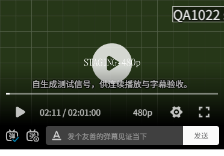
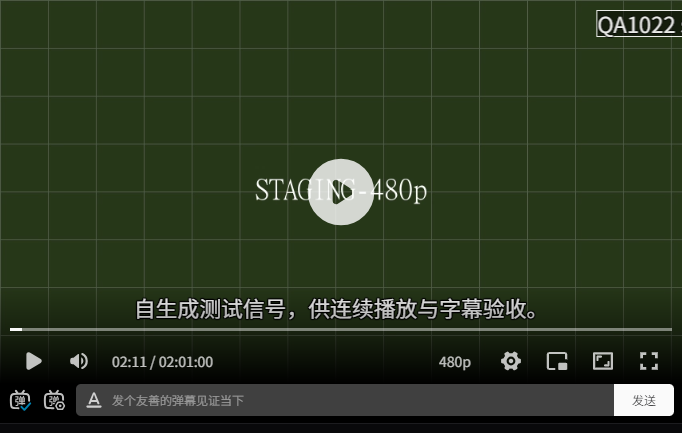

# 清晰度与弹幕 staging 验证

## 结论与范围

2026-10-22，清晰度常规切换与弹幕的 staging 定向自检通过，但**换档被暂停打断后停止保存进度**构成 T4.9 验收阻塞。真实手机和开发者最终确认仍待完成，不能标记两项整体验收通过。

- 环境：[测试站](https://video-development.startrekchina.org)，Workers Builds 来源 `60c3fa407d2bdcef90f779faaacdf8378faa8c36`，运行版本 `25b699e9-8038-4abe-b3c5-e79174371fb4`、100% 流量；核对运行时为 staging 及其独立 D1/R2 绑定。没有部署或 production 操作。
- 浏览器：Windows 上的隔离无界面 Chrome `155.0.8059.85`，Playwright 一次性驱动；成员、管理员和匿名分别使用独立上下文。390px 触摸模拟不是 iPhone 实机。
- 身份：两个本次专用虚构账号和短期会话；只验登录后的业务，不计作注册、登录、验证码或设备认证验收，不改站点认证配置。
- 媒体：已有自生成原画保持不变；为 SNW S02E02 新增自生成 720p / 480p MP4，各 7260 秒，H.264 + AAC、faststart，尺寸 1280×720 / 854×480，大小 3,731,098 / 3,420,544 字节。真实 Cron 自动验证并挂接，两档与原画时长一致；没有手工插入媒体记录。
- 本地临时驱动与原始记录位于被忽略的 `.cloudflare/acceptance/`，使用 `node .cloudflare/acceptance/browser.mjs`、`checks.mjs` 和 `switch-race.mjs`。依赖只安装在临时目录，项目依赖及业务代码未改动。

## 行为结果

| 场景 | 实际结果 |
| --- | --- |
| 暂停时切到 720p | 31.5 秒位置、暂停状态和 1.5 倍速保留；浏览器解码尺寸为 1280×720。 |
| 播放中切到 480p | 32.03→32.52 秒，继续播放且保留 1.5 倍速；解码尺寸为 854×480。此项不包含下节的暂停打断边界。 |
| 选择记忆及无档回退 | 刷新仍选 480p；进入只有原画的 S02E01 时无选择控件、播放原画，已存选择不丢失；返回 S02E02 再用 480p。 |
| 档位媒体权限 | 两档成员 Range 均为 `206`，0–15 字节正文各 16 字节，范围/长度正确，`private, no-store`；匿名 GET/HEAD 均 `401`，HEAD 无正文，不暴露媒体范围、类型和大小。 |
| 弹幕发送与显示 | 顶部黄、底部蓝、滚动白通过真实发送接口写入并显示；显示字体为站点 Noto Sans SC，位置与颜色和服务端记录一致。 |
| 发送过快 | 成员连续发送返回 `429` 和 `Retry-After: 5`；另通过真实服务端限流触发 UI 提示“发送太快”，被拒弹幕不出现在画面。 |
| 成员隐私 | 读取只含 `id, time, text, mode, color`，不含发送者；管理员列表显示虚构发送者。 |
| 屏蔽词与本机设置 | 大小写不同的包含匹配生效；添加词后当前匹配弹幕隐藏，回拖不出现，移除后恢复；显示类型、发送模式及颜色等设置刷新后保持。插件复用的隐藏 DOM 不等于仍在画面显示。 |
| 管理员删除 | 普通成员无入口，列表/删除直连 `403`；管理员跨单元删除 `404`，取消不删，确认后列表及成员读取均无记录，刷新不再显示，重复删除 `404`。 |
| 失效成员权限 | 虚构成员的邮箱设为未验证后，弹幕读写和两档媒体请求即时 `401`；独立恢复验证状态再封禁，同样拒绝旧会话。 |
| 布局与全屏 | 1440/700/390px、深浅主题可用，无页面横向溢出；宽屏发送框在控制栏，窄屏在播放器下方；390px 音量控件隐藏。桌面网页全屏与 Fullscreen API 进入/退出后发送框位置正确。390px 触摸模拟可点开菜单并切到 720p。 |

## 阻塞：换档暂停中断后的进度停滞

比较基线为上述运行版本；复现仅修改虚构账号的观看进度。

1. 正常播放并暂停，观察到一次进度请求，D1 保存 `11.033564` 秒、`revision = 1`。
2. 恢复播放并切到 720p，在该次换源的媒体 `play` 事件处受控调用原生 `pause()`，模拟换档自动续播被打断；不修改应用变量、媒体响应或服务端规则。
3. 浏览器抛出 `The play() request was interrupted by a call to pause()`。再次通过播放器按钮播放，持续观察超过 17 秒并暂停，视频到 `32.077799` 秒，但没有新增进度请求。
4. D1 仍为 `11.033564` 秒；刷新页面仍从该位置继续，证实不只是控制台噪声。此实验确定了事件边界及影响，不声称已测出真人操作中的发生概率。

原因：锁定的 ArtPlayer 5.4.0 在 `switchUrl` 的异步 `canplay` 回调中等待 `art.play()`，该调用因暂停而拒绝时没有结束外层换源 Promise。[播放器](../../../app/components/site/player.tsx)等待它后才在 `finally` 清除 `switching`；等待悬置时，后续 `timeupdate` 不再更新位置，暂停不上报，定时器也因位置未变而跳过。已有组件测试模拟 ArtPlayer，不能证明这一真实库边界正常。

本次未修改实现、锁定测试断言或发布代码。修复后需针对该中断边界及正常换档补回归，再在 staging 复验；不能通过忽略异常或只断言画面继续播放来放行。

## 中断修复与本地验证

2026-10-22，开发者授权修复、提交、合入本地 `dev`、推送及 staging 自动发布；不包含 `main` 或 production。

- pnpm 补丁只修改 ArtPlayer 5.4.0 当前动态导入使用的 ESM 入口，使续播拒绝结束外层换源 Promise；页面 `finally` 因而恢复进度跟踪，不增加超时或平行换源实现。
- `NotAllowedError` 提示“浏览器阻止自动播放，请点击播放。”；主动暂停的 `AbortError` 不显示故障，媒体错误仍使用既有 HEAD 分类与恢复按钮。
- `node .cloudflare/acceptance/library-regression.mjs`：真实 ArtPlayer、合成 MP4、隔离 Chrome，原生 seek/play/pause 边界在补丁前得到 `pending` 和未处理 `AbortError`；补丁后得到 `AbortError`，无未处理异常。正常播放/暂停换档的状态与倍速、模拟浏览器拒绝续播均通过。该脚本不修改应用状态，拒绝续播场景替换原生 `video.play` 返回值，不能视作真实浏览器策略验收。临时探针不属于持续回归门禁。
- `pnpm test test/player.test.ts test/playback.test.ts test/progress.test.ts test/danmaku.test.ts`：56 项通过。新增 3 项组件回归，原用例断言不变；新增 `NotAllowedError` 提示用例在实现修复前失败，修复后通过。组件测试模拟 ArtPlayer，真实库边界由上条探针证明。
- `pnpm install --frozen-lockfile`、`pnpm typecheck`、`pnpm build`（development）通过；没有升级依赖版本。保留 cf/Vite 的既有弃用和 React Router future flag 提示。
- staging 实际进度请求、D1 与刷新续播复验，以及播放器变化后的两小时以上自然播放仍待完成；真实手机和开发者确认不由本地结果代替。

## 证据与未覆盖项

- 清晰度菜单第一次自动点击发生遮挡超时；现场检查显示脚本未等待 200ms 菜单展开动画，并触发自动滚动。改为等待实际动画结束后正常点击通过，没有强制点击或修改产品样式。
- 屏蔽词的首次断言误把插件保留的隐藏节点计为可见弹幕；核对 `visibility: hidden` 后按可见状态断言，不修改应用实现或既有验收基线。
- 本地已有的每小时配额、3000 条读取、并发、格式校验、失败隔离等用例继续作为对应边界证据，不声称本次全部在云端重跑。没有业务代码变化，不重复类型检查、构建和全量测试。
- 真实手机的清晰度切换、触控/软键盘、横竖屏与原生全屏仍待开发者体验；桌面无界面浏览器的 Fullscreen API 和触摸模拟不替代实机。
- 两个虚构账号、会话、测试弹幕、观看进度和发送计数已按 ID 精确清理，分别核对为 0；未删除其他成员内容。浏览器全部关闭，没有启动开发服务器。
- 两个测试档位保留供复验，入口：[SNW S02E02](https://video-development.startrekchina.org/watch/series_103516_s2_e2)。文件为有档位标签的合成测试画面，不是真实剧集，不代表真实片源画质、码率或容量验收。

以下截图只含测试画面和播放器控件，无个人账号、评论或凭证：

